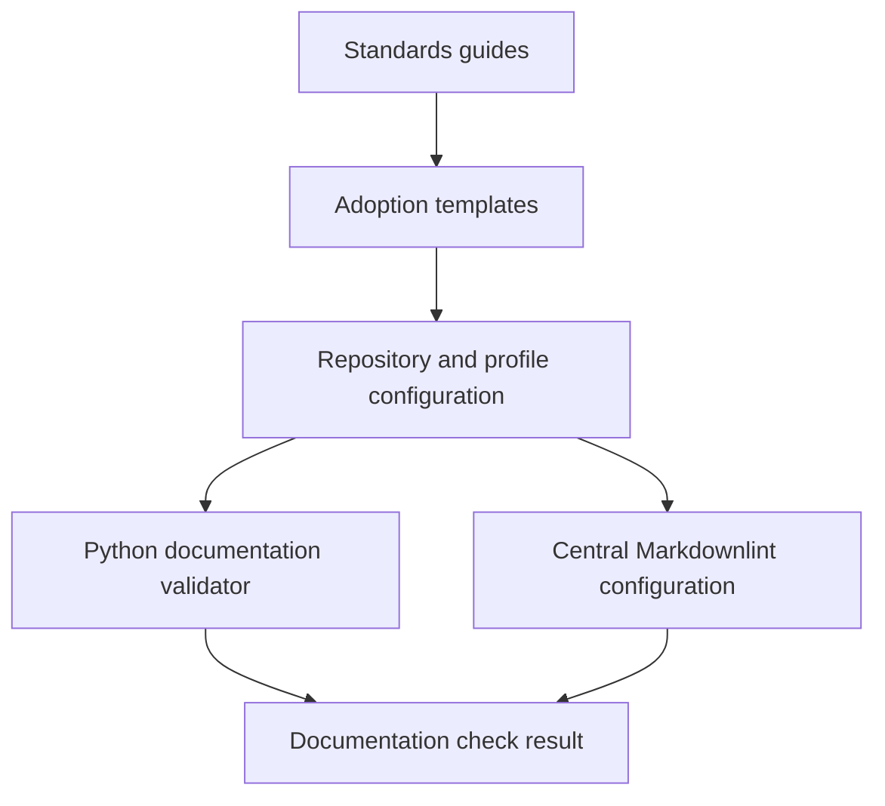

# Architecture

## Components

The four standards guides define human requirements. Templates demonstrate how to
adopt them. `.standards.json` selects the applicable documentation profile and
records justified extra guides. The Python validator checks objective requirements;
Markdownlint checks formatting. Neither decides whether an explanation is useful.

## Local validation

`scripts/validate_docs.py` accepts a repository path, reads `.standards.json`, and
returns actionable findings. The command returns exit code 1 for invalid config,
missing requirements, or broken local file links. Tests exercise temporary real
repositories, including successful and failing cases. No network is needed.

`additional_guides` maps maintained Markdown paths to their rationale. Required
guides are determined by the profile. Other active guides under `docs/` must be
registered and directly discoverable from the README Documentation section.
Exclusions cover generated/vendor material and historical planning artifacts.

## Automation boundary

Self CI runs tests, formatting, and self-validation. The reusable workflow checks
out caller content and central tools into separate directories. Its required
`standards-ref` input pins the tools; callers must set it to the same immutable
revision as their reusable-workflow reference. This explicit duplication avoids
extra token permissions or fetching tools from a moving branch. A maintainer must
review the two refs together.

The workflow runs central tools against the consumer but does not execute consumer
scripts. Stack-specific tests remain in each project's own workflow. This keeps a
documentation gate small and avoids inventing a universal language runner.

## Tradeoffs and limits

A small standard-library checker keeps adoption cheap but supports a defined
Markdown subset. External URLs and heading anchors are deliberately unchecked.
Source folder conventions, dependency compatibility, prose quality, and diagram
rendering need review and project-specific checks. A later release may replace the
link subset with a full parser if real repositories need it.

Adoption is explicit. GitHub's supported community defaults are a separate
mechanism, scoped to the owning account. Publication and required status-check
settings are outside this local foundation.
