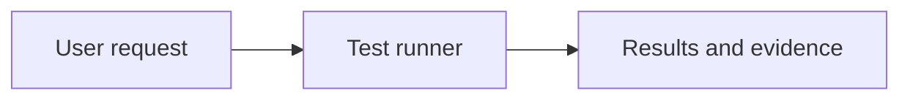

# Documentation standard

## Requirements and profiles

MUST means required for adoption, SHOULD means the normal choice with a justified
exception, and MAY means optional. Choose one profile in `.standards.json`:

| Profile | Applies to | Required documents |
| --- | --- | --- |
| `small` | Utilities, examples, starter templates | Root `README.md` |
| `complete` | Complete frameworks and applications | README, `docs/development.md`, `docs/architecture.md` |
| `personal` | Profiles, portfolios, resumes, learning notes | Root README suited to its audience |
| `standards` | This central repository | README, development, and architecture guides |

A portfolio may use `personal` when documentation serves personal content. Use
`complete` when presenting it as a maintained application for other developers.
A starter must explain how to copy it, replace sample values, and verify it works.
Small projects keep development and architecture information in the README until
separate guides improve navigation. Promote the profile when complexity grows.

## Root README

Code profiles MUST include these level-two headings in this order:

1. `Quickstart`: prerequisites, installation, safe sample configuration, and one
   runnable command with the expected result. Readers must get a first success.
2. `Usage`: the primary task and a concrete example, with links to detailed options.
3. `Verification`: exact test/check commands and what CI actually proves.
4. `Documentation`: a short navigation index when maintained guides exist.

Begin with one H1 project name and a short description of purpose and intended
users. A short motivation or how-it-works section MAY precede Quickstart. A small
structure tree MAY explain important folders. License information MUST match the
repository's actual license; public code projects SHOULD use MIT under the existing
portfolio convention. Personal content must retain its own licensing decision.

A screenshot MAY show a visual product or report. Use a few meaningful badges;
avoid decorative badges and hand-maintained version badges that become stale.
Do not put full contributor setup, exhaustive CLI options, generated reports,
long troubleshooting catalogs, or historical design discussion in the README.

`personal` requires meaningful content but does not enforce code-project headings.

## Maintained guides

`docs/development.md` serves someone modifying the project: environment setup,
configuration names and defaults, checks, representative integration runs, and
troubleshooting. Link to commands already explained elsewhere instead of copying
whole sections.

`docs/architecture.md` explains component responsibilities, interfaces, data flow,
and important tradeoffs. A diagram is useful when relationships need explanation;
a diagram is not mandatory for a simple linear project.

There is no document-count limit. An additional guide MUST have a distinct task or
audience, no duplicated instructions, and a direct link from the README's
Documentation section. Examples include CLI reference, deployment, an agent
protocol, and performance-test operation. Register the guide's repository-relative
path and rationale in `additional_guides`:

```json
{
  "profile": "complete",
  "additional_guides": {
    "docs/cli.md": "Operators need an extensive command and option reference"
  },
  "exclude": []
}
```

Every additional Markdown guide under `docs/` needs a nonempty rationale. Required
architecture and development guides need none. A small/personal project that adds
those guides must justify them like other additional guides. Exclusions MUST NOT
hide maintained guides or broken links. Excluded paths need review like any other
exception; the validator is a check, not an adversarial policy boundary.

## Formatting and diagrams

- Use UTF-8, LF newlines, a final newline, one H1, and sentence-case headings.
- Do not skip heading levels. Prefer short paragraphs and flat lists.
- Use fenced code blocks with language labels and shell commands that readers can
  run from a stated directory. Never include live credentials or personal data.
- Use relative links for local files, descriptive link text, and lowercase
  hyphenated names for new maintained guides. Update inbound links when moving files.
- Prefer Mermaid for component and sequence diagrams rendered by GitHub. Explain
  the diagram in prose and keep labels understandable. Store needed screenshots
  and exports in `docs/assets/`, with descriptive filenames and Markdown alt text.
- Capture screenshots only when they teach something; update them with the flow.
- Formatting checks do not replace review of accuracy, runnable examples, or accessibility.

Example diagram:



## Other Markdown files

Root policy and lifecycle files such as CONTRIBUTING, SECURITY, CHANGELOG,
ROADMAP, and LICENSE retain their conventional locations when needed. Do not create
empty policies. Agent instructions, prompts, task plans, generated references, and
vendored files are not user guides and should retain their functional locations.

Historical plans and design artifacts MAY live in `docs/superpowers/`, clearly
marked as historical in the README. They are excluded from maintained-guide
requirements, not a substitute for current architecture documentation. No blanket
requirement for ADRs or a separate documentation index exists in this release.

## Review and exceptions

Check technical changes and related documentation in the same PR. An exception
records the affected rule, reason, validation evidence, owner, and review trigger
in an existing relevant guide or adoption PR. Avoid creating another file merely
to document one exception. Reassess obsolete guides when adding a new one.
